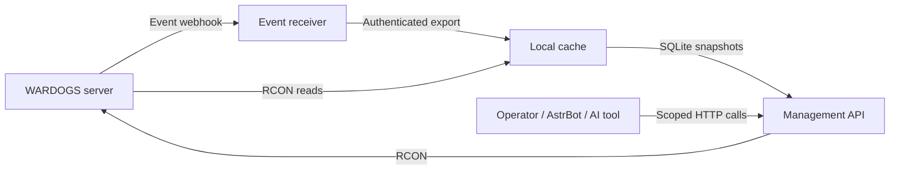

# WARDOGS Server Toolkit

[简体中文](README.zh-CN.md) · [Operations](docs/OPERATIONS.md) · [AI integration](AGENTS.md) · [API contract](service/openapi.json)

Archived, self-hosted management tools for a WARDOGS server you operate. The toolkit includes an authenticated management API, a webhook receiver, a local event and chat cache, and command-line clients. WARDOGS and its server binaries are separate. The original deployment is retired. This snapshot is provided as-is with no ongoing maintenance.



## Quick start

Requires Docker Compose, a compatible WARDOGS HTTP RCON endpoint, and permission to operate that server. The example binds HTTP ports to loopback. Automatic sanctions, broadcasts and admin or report tokens are disabled by default.

```sh
cp .env.example .env
mkdir -p data .secrets
chmod 700 data .secrets
(umask 077; openssl rand -hex 32 > .secrets/service_api_key)
```

Set `RCON_HOST` and optionally `RCON_PORT` in `.env`. Save your RCON credential in `.secrets/rcon_key` with mode 0600. Set the UID and GID to the owner of these files and `data/`.

```sh
docker compose up -d --build
python service_client.py health
python service_client.py match
```

Use the [operations guide](docs/OPERATIONS.md) to enable events, scoped administration or report execution. For group chat integration, see [AstrBot WARDOGS Archive](https://github.com/RhoninSeiei/astrbot-plugin-wardogs-archive).

The repository is licensed under [Apache-2.0](LICENSE). Published source and tests exclude the former deployment's databases, credentials, operational history and site-specific jobs.
