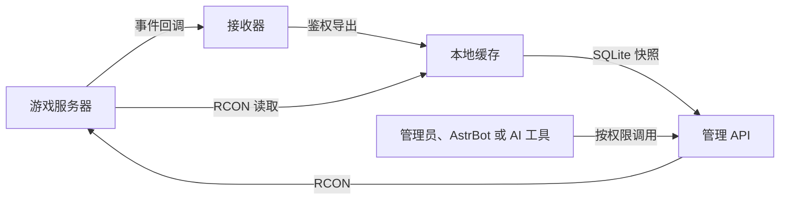

# WARDOGS 服务器管理工具

[English](README.md) · [使用与运维](docs/OPERATIONS.md) · [AI 接入指南](AGENTS.md) · [API 契约](service/openapi.json)

适用于自主管理的 WARDOGS 服务器，包含管理 API、事件回调接收器、本地事件及聊天缓存和命令行工具。原服务器已关闭，仓库随公开归档，后续不再维护。游戏及服务端程序另行提供。

复制 `.env.example` 为 `.env`，填入 RCON 主机、端口和运行用户。创建 `data/` 与 `.secrets/`，将 RCON 密钥放入 `.secrets/rcon_key`，使用 `openssl rand -hex 32` 生成独立的 `.secrets/service_api_key`，密钥文件权限设为 0600。执行 `docker compose up -d --build`，再执行 `python service_client.py health` 和 `python service_client.py match`。默认只监听本机，自动处罚、主动通告和高权限令牌默认关闭。

事件采集、管理权限、恢复流程见 [使用与运维](docs/OPERATIONS.md)。群聊接入使用 [AstrBot WARDOGS 插件](https://github.com/RhoninSeiei/astrbot-plugin-wardogs-archive)。源码采用 [Apache-2.0](LICENSE)。
